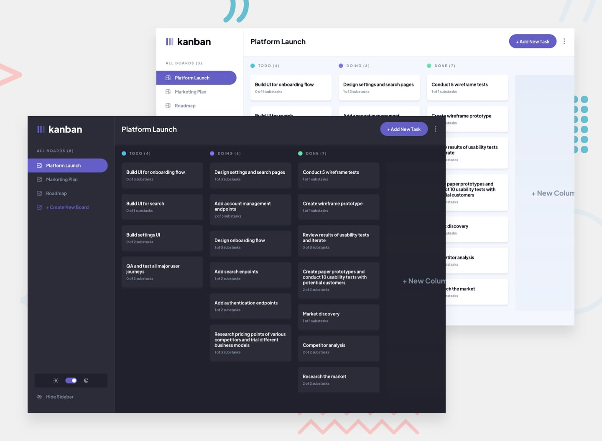

# Frontend Mentor — Kanban task management web app

A full-stack Kanban task management web app built with Next.js 16, TypeScript, Tailwind CSS v4, and Supabase. Solution to the [Frontend Mentor Kanban challenge](https://www.frontendmentor.io/challenges/kanban-task-management-web-app-wgQLt-HlbB).



## Table of contents

- [Overview](#overview)
  - [The challenge](#the-challenge)
  - [Built with](#built-with)
- [Getting started](#getting-started)
  - [1. Create a Supabase project](#1-create-a-supabase-project)
  - [2. Run the schema](#2-run-the-schema)
  - [3. Configure environment variables](#3-configure-environment-variables)
  - [4. Install and run](#4-install-and-run)
- [Project structure](#project-structure)
- [Auth flow](#auth-flow)
- [Notes](#notes)

## Overview

### The challenge

Users can:

- View the optimal layout for the app on any screen size
- See hover states on all interactive elements
- Create, read, update, and delete boards and tasks (with form validation)
- Mark subtasks as complete and move tasks between columns
- Drag and drop tasks within and between columns (bonus)
- Hide / show the board sidebar
- Toggle the theme between light and dark mode
- Sign up, sign in, and have their boards persisted across devices (full-stack bonus)

### Built with

- **[Next.js 16](https://nextjs.org/)** (App Router, React 19, Server Actions)
- **TypeScript**
- **[Tailwind CSS v4](https://tailwindcss.com/)** (CSS-first `@theme` config)
- **[Supabase](https://supabase.com/)** — Postgres, Auth, RLS
- **[@supabase/ssr](https://github.com/supabase/auth-helpers)** — cookie-based session refresh in middleware
- **[next-themes](https://github.com/pacocoursey/next-themes)** — light / dark mode
- **[@dnd-kit](https://dndkit.com/)** — accessible drag-and-drop
- **[Zod](https://zod.dev/)** — form validation in server actions

## Getting started

### 1. Create a Supabase project

1. Sign up at [supabase.com](https://supabase.com) and create a new project.
2. From your project dashboard, grab the **Project URL** and **anon public key** (Settings → API).

### 2. Run the schema

Open the SQL editor in your Supabase dashboard, paste the contents of [`supabase/schema.sql`](./supabase/schema.sql), and run it. This creates the four tables (`boards`, `columns`, `tasks`, `subtasks`), foreign-key cascades, and row-level-security policies that limit each row to its owner.

### 3. Configure environment variables

```bash
cp .env.local.example .env.local
```

Fill in:

```bash
NEXT_PUBLIC_SUPABASE_URL=https://<project-ref>.supabase.co
NEXT_PUBLIC_SUPABASE_ANON_KEY=<your-anon-key>
```

### 4. Install and run

```bash
npm install
npm run dev
```

Open [http://localhost:3000](http://localhost:3000), create an account, and the app will seed your account with the sample boards from `src/data/seed.json` (the original starter `data.json`).

## Project structure

```
src/
├── app/
│   ├── (auth)/                 # sign-in, sign-up, server actions
│   ├── auth/callback/          # OAuth / magic-link callback
│   ├── boards/[boardId]/       # the main board view
│   ├── layout.tsx              # ThemeProvider + Plus Jakarta Sans
│   └── page.tsx                # redirects to first board, or empty state
├── components/
│   ├── modals/                 # board form, task form, view-task, confirm delete
│   ├── app-shell.tsx           # sidebar + header + main + modals composition
│   ├── board-view.tsx          # columns + dnd-kit sortable task cards
│   ├── header.tsx              # board name, add task, options menu
│   ├── sidebar.tsx             # boards nav + theme toggle + hide button
│   ├── mobile-sidebar.tsx      # mobile board picker sheet
│   ├── theme-toggle.tsx
│   └── ui-store.tsx            # React Context for modal + sidebar state
├── lib/
│   ├── actions/                # server actions (boards, tasks)
│   ├── supabase/               # browser, server, middleware clients + types
│   ├── queries.ts              # server-side data loaders
│   ├── seed.ts                 # imports starter data.json into a new account
│   └── utils.ts                # cn(), column dot palette
├── middleware.ts               # session refresh + auth redirects
└── data/seed.json              # starter board data
```

## Auth flow

1. The `middleware.ts` calls `updateSession()` on every request to refresh the Supabase session cookie.
2. Unauthenticated requests to anything other than `/sign-in`, `/sign-up`, or `/auth/callback` redirect to `/sign-in`.
3. Authenticated requests to `/sign-in` or `/sign-up` redirect to `/`.
4. After sign-up the `signUpAction` calls `seedUserBoards()` so the new account starts with the sample boards.
5. RLS policies on every table key off `auth.uid() = user_id`, so a misconfigured query simply returns nothing rather than leaking another user's data.

## Notes

- The original `starter-code/` and `kanban-task-management-web-app.fig` design files are kept in the repo root for reference. They are excluded from the build.
- The seed step is idempotent — it only runs if the user has zero boards, so re-signing in won't duplicate data.
- Drag-and-drop persists positions through `moveTaskAction`, which reflows positions in both the source and destination columns.
- Email confirmation is **on** by default in Supabase. Either disable it (Authentication → Settings → "Confirm email") for instant sign-in, or click the confirmation link before signing in. The seed runs on first successful sign-in either way.
